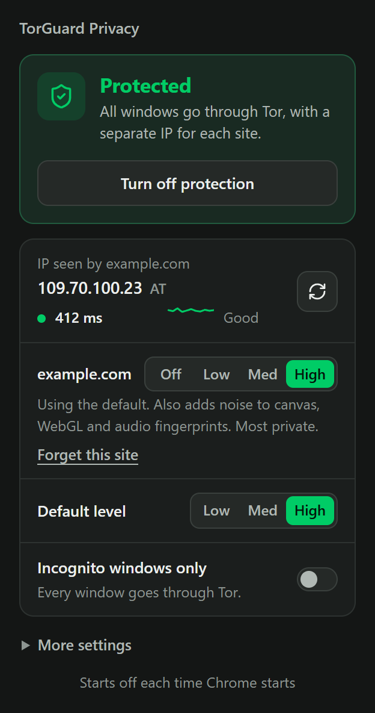
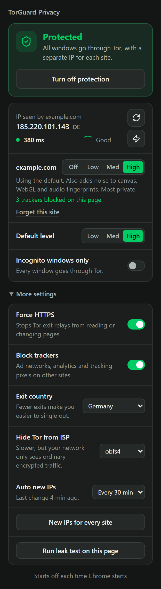
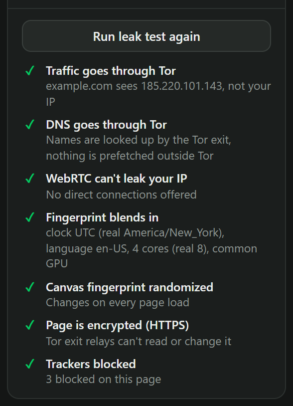

# torguard-privacy

chrome extension + a couple scripts that push ur browser thru tor, give every site its own ip and fuck with fingerprinting so sites cant follow u around.

it can do it only for incognito windows (default) or for everything. it starts OFF every time chrome starts, u turn it on when u actually want it.

<p>
  
  &nbsp;&nbsp;
  
</p>

## what it does

- **tor for everything** (or just incognito). theres no direct fallback, so if tor dies pages just fail instead of leaking ur real ip
- **different ip per site.** every site gets its own tor circuit so google and some random shop dont see the same ip. subdomains stay together so logins dont break
- **new ip button.** swaps the site's tor port so chrome has to reconnect and the page really sees a new ip (just telling tor "new circuit" doesnt work, chrome keeps the open connection). u can do just the site ur on or every site
- **security levels per site.** off / low / med / high, remembered per site, plus a default for everything else
- **live ping** for the site's circuit, measured without even touching the site
- **blocked page detection.** if a site throws a cloudflare "sorry, you have been blocked" at u, the popup notices and gives u buttons for a new ip or turning tor off for that site
- **force https** so a sketchy exit node cant read or mess with pages
- **exit country** if u want all exits in one country (needs tor's geoip files, see setup)
- **auto new ips** every 10 / 30 / 60 min
- **forget this site.** nukes its cookies (even the httponly login ones) and storage
- **tracker blocking.** google analytics, the facebook pixel, doubleclick, criteo, hotjar and ~100 other ad / analytics / session replay crap, but only when they load on OTHER sites so nothing breaks. the popup tells u how many it killed on the page
- **hide tor from ur isp.** bridges (obfs4 / snowflake / meek) so ur wifi or isp just sees normal encrypted traffic instead of "this guy uses tor". uses the built in bridges from ur tor bundle
- **fastest ip button** (the ⚡ one). tries 4 circuits for the site, pings them, keeps the quickest
- **leak test.** one click checks tor, dns, webrtc, fingerprint, https and trackers on the page ur on
- **one click start** (optional). run `install_host.bat` once and the turn on button starts tor itself, so u dont need the .bat window open. see below
- toolbar badge shows the level for each tab (H / M / L / OFF, or ! if something broke)



(the "real" values in the leak test are from a test machine, not mine lol)

### levels

| level | what u get |
|---|---|
| **off** | no tor for that site at all, it sees ur real ip. for sites that block tor. other sites cant embed stuff from it (videos, widgets), that would leak ur real ip on them |
| **low** | tor + webrtc/dns leak protection + https. pages see ur real device stuff. least likely to get blocked |
| **med** | also fakes the clock (UTC), language (en-US), cpu, memory, gpu and os version |
| **high** | also adds noise to canvas / webgl / audio fingerprints (changes every load), inside web workers too. this is the default |

## setup (windows)

1. get the **tor expert bundle** from https://www.torproject.org/download/tor/ and extract it into this folder so u have `tor\tor.exe` and `data\geoip` (or set `TOR_HOME` to wherever ur tor is)
2. python stuff: `pip install -r requirements.txt`
3. chrome → `chrome://extensions` → turn on developer mode → **load unpacked** → pick the `extension` folder
4. on the extension's details page turn on **allow in incognito** or incognito mode does nothing
5. either run `install_host.bat` once (then the button starts tor for u), or run `start_privacy.bat` and leave it open
6. click the icon → turn on protection

## one click start (install_host.bat)

chrome has this thing called native messaging: an extension can talk to ONE program on ur pc that u registered. `install_host.bat` registers `host/torguard_host.py` for chrome / edge / brave and thats it. when u hit turn on, the extension asks it to start tor + the rotator, turn off stops them again.

the host can only do 3 things (start / stop / status), only this extension (its id is fixed) is allowed to talk to it, and stop only kills the tor IT started, so a tor from `start_privacy.bat` is left alone.

trade offs, cuz there are some:

- **one time setup.** it adds one registry key under ur user (no admin). `install_host.bat --uninstall` removes it. move the repo folder = run it again
- **its a door from chrome to ur pc.** a tiny one (it cant run anything else) but still, if u dont want that just use the .bat
- **tor takes a few secs** every time u turn it on (~10-30s, longer with snowflake). the popup shows "Starting Tor…" till its up
- **tor keeps running after chrome closes**, until u turn protection off or chrome starts again (then it gets stopped cuz protection always starts off)
- **still needs python** installed, same as the rotator
- Script.py (other apps thru tor) still goes thru `start_privacy.bat`

## bridges (hide tor from ur isp)

| | how it looks to ur isp | speed |
|---|---|---|
| **off** | "connects to tor" (public list of relays) | normal |
| **obfs4** | random looking encrypted traffic | bit slower |
| **snowflake** | looks like a video call (webrtc) to random volunteers | slowest |
| **meek** | looks like normal https to a big cdn | slow |

turning it on while tor is running switches new connections right away, the old ones fade out in a few minutes. its saved to `torguard-bridges.conf` so next time tor uses bridges from the very first connection. the bridges are the public built in ones, so if ur country blocks those u'll need private ones from bridges.torproject.org

## how the per site ip thing works

tor never lets connections from different SocksPorts share a circuit. so `tor_rotator.py` opens 16 extra SocksPorts and the extension sends each site to one of them (it hashes the domain). new ip = swap in fresh port numbers, so chrome cant reuse its old connections and tor has to build new circuits. if a port dies (like tor restarted) it falls back to 9050, never to a direct connection.

the rotator is a tiny local api on `127.0.0.1:8222`:

```
/status?slot=N                 exit ip a site on slot N sees
/ports                         the per site ports that are open (extension checks every 30s)
/rotate?slot=N&scope=site|all  new circuit for one site or all of them
/ping?port=P&host=H            round trip thru that circuit
/exit?country=de|any           only use exits in one country
/fastest?slot=N&host=H         try 4 circuits for a site, keep the quickest
/bridges?mode=off|obfs4|snowflake|meek   hide tor from ur isp
```

## if a site blocks u

thats the site's firewall blocking tor, mostly cloudflare. nothing on ur end can make a site that blocks all of tor accept tor, period. what u can do:

- try a new ip (works when they only block some exits)
- drop that site to low (if a bot check was freaking out over the fingerprint stuff)
- set it to off. always works but then that site sees ur real ip

## what it cant do

being real here, its still chrome. it cant hide ur installed fonts or window size, shared/service workers arent covered, and sites with a strict CSP get their workers unprotected (otherwise theyd break). if u actually need to be anonymous use **tor browser**, this aint that. this is for making tracking a pain in the ass in normal chrome.

## Script.py

launcher that runs any app thru tor (sets the windows proxy for electron apps). `start_privacy.bat "C:\path\to\app.exe"` starts tor + rotator and launches the app thru it. without an arg the bat just runs tor + the rotator.

## files

```
extension/         the chrome extension, load this folder
host/              native host for the one click start (+ install.py)
install_host.bat   registers the host (--uninstall to remove)
tor_rotator.py     local api: per site ips, new ips, ping, fastest, exit country, bridges
start_privacy.bat  starts tor + rotator by hand (and Script.py if u give it an app)
Script.py          run other apps thru tor
```

## license

MIT, do whatever u want with it. see [LICENSE](LICENSE)
